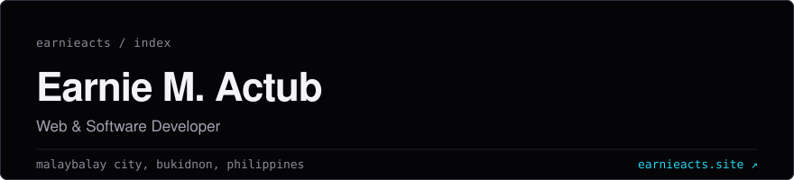

I build microservices and full-stack systems for Bukidnon State University and ship products at GapLinker. These days I lean heavily on AI-assisted development.

`~2` yrs shipping &nbsp;·&nbsp; `4` live products &nbsp;·&nbsp; `6` languages in production &nbsp;·&nbsp; `2023` BSIT graduate

[portfolio ↗](https://earnieacts.site) &nbsp;·&nbsp; [linkedin ↗](https://www.linkedin.com/in/earnie-actub-513a0b225/) &nbsp;·&nbsp; [email ↗](mailto:renactub@gmail.com)

---

### 01 &nbsp; experience

**Web Developer**, Bukidnon State University, Information Technology Unit
 Malaybalay City &nbsp;·&nbsp; dec 2023 to present

- Build and maintain microservices that support core university systems.
- Develop REST APIs with FastAPI and the Frappe Framework for internal integrations.
- Contribute feature updates to existing .NET (C#) systems.
- Create responsive web interfaces with React, TypeScript, and Tailwind CSS.
- Develop cross-platform mobile apps with Flutter for internal users.
- Design and manage PostgreSQL, MySQL, and NoSQL databases.
- Deploy and containerize services with Docker.
- Use AI tools such as Claude to speed up development, debugging, and code review.

---

### 02 &nbsp; work &nbsp; [github ↗](https://github.com/earnieacts)

| | |
| --- | --- |
| **[Bondie](https://bondieapp.com)**  GapLinker | A photo-widget app for the people you love. Take a photo and it appears on their home-screen widget, visible only to people you approve. Live on [Google Play](https://play.google.com/store/apps/details?id=com.bondieapp.app), iOS beta on [TestFlight](https://testflight.apple.com/join/y3Pxkdf1).  Go · PostgreSQL · Kubernetes · Expo · React Native · TypeScript |
| **[TableSnap](https://tablesnap.io)**  GapLinker | A loyalty rewards platform for independent restaurants. Browse menus, order, and earn points redeemable at every restaurant on the platform. |
| **[FetchExpress](https://fetchexpress.ph)**  GapLinker | A community-operated errands and delivery app for the Philippines. Customers choose a specific nearby rider; shipped on iOS and Android. |
| **Microservices Application**  BukSU | Internal university services on a microservices architecture, deployed as containers.  Python · FastAPI · Docker · REST APIs |
| **Full-Stack Web Application**  BukSU | An internal web application: a component-based front end wired to the service layer.  React · TypeScript · Tailwind CSS · REST APIs |

---

### 03 &nbsp; stack &nbsp; 10 domains

| | |
| --- | --- |
| **Languages** | Python · C# · Go · TypeScript · JavaScript · Dart |
| **Frameworks & Backend** | FastAPI · .NET (C#) · Node.js · Express.js · Laravel · Frappe Framework |
| **Frontend** | React · Vue.js · Tailwind CSS · shadcn/ui · Vite · HTML · CSS |
| **Mobile** | Flutter · React Native · Expo |
| **Databases** | PostgreSQL · MySQL · MongoDB · NoSQL |
| **DevOps & Cloud** | Docker · Kubernetes · GitHub Actions · Cloudflare |
| **Security & Identity** | Keycloak · JWT |
| **Practices** | REST APIs · Microservices |
| **Developer Tools** | Git · GitHub · VS Code · Zed · Discord · Slack |
| **AI Utilization** | Claude · Claude Code · OpenCode · AI-assisted development · Prompt engineering · AI-driven code review |

---

### 04 &nbsp; about &nbsp; [résumé, pdf ↗](https://earnieacts.site/resume.pdf)

At Bukidnon State University's IT Unit I build and maintain the microservices behind core systems: REST APIs in FastAPI and Frappe, feature work on existing .NET services, and the React interfaces that sit on top of them.

At GapLinker I work on live products: TableSnap, FetchExpress, and Bondie. Across both I move through the whole stack rather than one layer of it.

> AI makes me faster, not looser. It speeds up the writing; the reviewing, the naming, and the boring correctness are still mine.

BS Information Technology, Bukidnon State University, 2023

---

### 05 &nbsp; now &nbsp; updated nov 2026

- **Microservices for university systems.** Extending the service layer behind BukSU's core systems, and the REST APIs that integrate them.
- **Product work at GapLinker.** Iterating on TableSnap, FetchExpress, and Bondie, now live on Google Play.
- **AI-assisted development.** Claude and Claude Code day to day for prompting, code review, and debugging.
- **Cross-platform mobile.** Building Flutter applications for internal university users.

---

### 06 &nbsp; affiliations

**[GapLinker](https://gaplinker.com)**: a startup closing the gap between real problems and solutions. It designs, builds and runs its own products end to end, including FetchExpress PH, TableSnap, and the SIAS AI Executive Dashboard.

---

### 07 &nbsp; say hello &nbsp; [renactub@gmail.com ↗](mailto:renactub@gmail.com)

[portfolio ↗](https://earnieacts.site) &nbsp;·&nbsp; [linkedin ↗](https://www.linkedin.com/in/earnie-actub-513a0b225/) &nbsp;·&nbsp; [github ↗](https://github.com/earnieacts)
